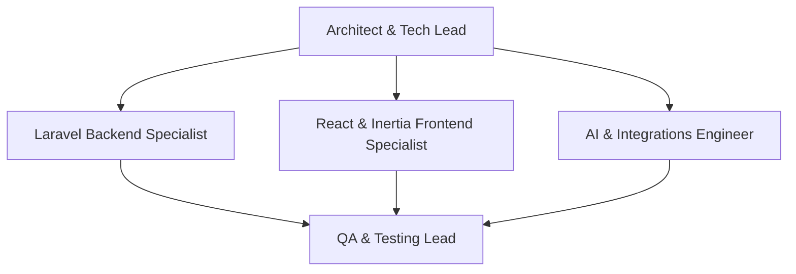

# AGENTS.md — SnapStudy Project Guide & Team Configuration

Bienvenido al repositorio de **SnapStudy**. Este documento contiene la configuración del equipo de agentes de IA, roles de desarrollo, convenciones arquitectónicas, reglas de codificación y flujos de trabajo recomendados para colaborar de manera consistente y eficiente en el proyecto.

---

## 1. Visión General del Proyecto

**SnapStudy** es una plataforma educativa integral impulsada por inteligencia artificial diseñada para estudiantes. Permite digitalizar, estructurar y estudiar apuntes de forma inteligente y colaborativa.

### Capacidades Principales
- **Digitalización & OCR Inteligente**: Carga o recorte de fotografías de cuadernos y apuntes físicos, transformándolos en texto estructurado en Markdown mediante la API nativa de Google Gemini (`gemini-3.1-flash-lite`).
- **Generación Automática de Flashcards**: Creación asistida por IA de tarjetas de estudio pedagógicas (pregunta/respuesta) a partir del contenido de los apuntes.
- **Personalización por Estilo de Aprendizaje (VARK)**: Onboarding inicial que detecta el estilo cognitivo del usuario (*Visual, Auditivo, Lectoescritura, Kinestésico*).
- **Feed Social y Explorador**: Descubrimiento de apuntes públicos organizados por materias o asignaturas, búsqueda por palabras clave e interacción social (guardar apuntes / forks, comentarios).
- **Dashboard de Estudio**: Métricas de apuntes creados, guardados y estadísticas de racha.

---

## 2. Stack Tecnológico

| Capa | Tecnologías | Notas |
| :--- | :--- | :--- |
| **Backend** | PHP 8.2+, Laravel 12 | Enrutamiento web, controladores delgados, form requests, policies y migraciones. |
| **Frontend** | React 18, Inertia.js v2, Vite 7 | SPA monolítica moderna sin API REST desacoplada; renderizado e interacción vía Inertia v2 (`@inertiajs/react`). |
| **Estilos & UI** | Tailwind CSS 3/4, Headless UI, Heroicons | Diseño moderno, responsivo y accesible. |
| **Herramientas Cliente** | `react-cropper`, `axios`, `ziggy-js` | Recorte interactivo de imágenes y resolución de rutas de Laravel en React. |
| **IA & Multimodalidad** | Google Gemini API (`gemini-3.1-flash-lite`) | Extracción OCR mediante vision prompts (`inline_data`) y generación estructurada de JSON vía `generationConfig` y `responseSchema`. |
| **Base de Datos** | SQLite (por defecto en local) / PostgreSQL (producción/Supabase) | Relaciones Eloquent: Users, Posts, Flashcards, Comments, Interactions, SavedPosts. |
| **Testing & Calidad** | Pest PHP v3, PHPUnit, Laravel Pint | Pruebas de integración/features y formateador de código PSR-12. |

---

## 3. Configuración del Equipo de Agentes (Team Personas)

Al abordar tareas en este proyecto, los agentes deben asumir los siguientes roles según el área de impacto:



### 1. 🛡️ Architect & Tech Lead
- **Responsabilidad**: Velar por la cohesión del sistema, integridad de esquemas de base de datos, seguridad en autenticación/autorización y consistencia de las decisiones arquitectónicas.
- **Foco**: Asegurar que las nuevas características respeten la arquitectura Inertia + Laravel 12, prevengan deuda técnica, eliminen código muerto y no introduzcan duplicidades ni dependencias innecesarias.

### 2. 🐘 Laravel Backend Specialist
- **Responsabilidad**: Modelos Eloquent, migraciones, controladores delgados, validaciones de formularios (Form Requests) y políticas de autorización (Policies).
- **Foco**:
  - Definición explícita de `$fillable` y `$casts`.
  - Validación estricta en Form Requests dedicados (`app/Http/Requests`), prohibiendo validaciones inline en controladores.
  - Manejo de relaciones y queries optimizadas (evitar problema N+1 usando `with()` / `withCount()`).
  - Autorización adecuada delegada a Policies (`PostPolicy`, `CommentPolicy`) mediante `$this->authorize()` o Gates.

### 3. ⚛️ React & Inertia Frontend Specialist
- **Responsabilidad**: Interfaces de usuario en `resources/js/Pages` y `resources/js/Components`.
- **Foco**:
  - Experiencia de usuario (UX) fluida, retroalimentación visual inmediata durante estados de carga de la IA.
  - Uso correcto del hook `useForm` de Inertia e imports exclusivos desde `@inertiajs/react`.
  - Integración de Tailwind CSS con paletas coherentes, bordes redondeados y micro-interacciones.

### 4. 🤖 AI & Integrations Engineer
- **Responsabilidad**: Prompts de extracción multimodal, generación de flashcards y manejo de clientes HTTP hacia Google Gemini API a través de `GeminiAiService`.
- **Foco**:
  - Salidas estrictamente tipadas mediante `generationConfig`, `responseMimeType: "application/json"` y `responseSchema`.
  - Tolerancia a fallos, manejo de excepciones (`Http::timeout(45)`), control de rate limits (429) y logging detallado (`Log::error`).
  - Sanitización y mapeo bidireccional del contenido generado antes de responder al cliente o persistir en base de datos.

### 5. 🧪 QA & Testing Lead
- **Responsabilidad**: Suites de prueba en `tests/Feature` y `tests/Unit` utilizando Pest.
- **Foco**:
  - Cobertura de rutas críticas (autenticación, creación de posts, políticas de autorización, tests de onboarding).
  - Falsificación de llamadas HTTP externas hacia Gemini (`Http::fake(['https://generativelanguage.googleapis.com/*' => ...])`) para pruebas deterministas y sin consumo de cuota.

---

## 4. Estructura del Repositorio

```plaintext
snapstudy-laravel/
├── app/
│   ├── Http/
│   │   ├── Controllers/
│   │   │   ├── Auth/                    # Controladores de Breeze (Login, Registro, etc.)
│   │   │   ├── CommentController.php    # Creación y borrado de comentarios (con Policy)
│   │   │   ├── OnboardingController.php # Test VARK y estilo de aprendizaje
│   │   │   ├── PostController.php       # Controlador delgado de apuntes (inyecta GeminiAiService)
│   │   │   └── ProfileController.php    # Gestión de cuenta de usuario
│   │   ├── Middleware/                  # Middlewares HTTP y de Inertia
│   │   └── Requests/                    # Form Requests dedicados (StorePost, ExtractOcr, StoreComment, etc.)
│   ├── Models/
│   │   ├── Comment.php                  # Comentarios en apuntes
│   │   ├── Flashcard.php                # Tarjetas de memoria generadas (pertenecen a Post)
│   │   ├── Interaction.php              # Likes y métricas
│   │   ├── Post.php                     # Apunte principal (título, contenido, imagen, materia)
│   │   ├── Subject.php                  # Materias / Asignaturas
│   │   └── User.php                     # Usuario con learning_style y relaciones
│   ├── Policies/                        # Políticas de autorización (PostPolicy, CommentPolicy)
│   ├── Providers/
│   │   └── AppServiceProvider.php
│   └── Services/
│       └── GeminiAiService.php          # Servicio exclusivo de integración con Google Gemini API
├── bootstrap/
│   └── app.php                          # Configuración central de routing, middleware y excepciones (Laravel 12)
├── config/                              # Configuraciones de Laravel (services.php, database.php, etc.)
├── database/
│   ├── factories/                       # Factories para testing (User, Post, Comment)
│   ├── migrations/                      # Esquemas de base de datos
│   └── seeders/                         # Datos iniciales para desarrollo
├── resources/
│   ├── css/                             # CSS base y directivas Tailwind
│   └── js/
│       ├── Components/                  # Componentes reutilizables (Botones, Modales, Inputs)
│       ├── Layouts/                     # AuthenticatedLayout, GuestLayout
│       └── Pages/                       # Vistas Inertia (Dashboard, Explore, Posts, Onboarding)
├── routes/
│   ├── auth.php                         # Rutas de autenticación
│   └── web.php                          # Rutas web de la aplicación
├── tests/
│   ├── Feature/                         # Pruebas funcionales con Pest (GeminiAiTest, PostPolicyTest, etc.)
│   └── Unit/                            # Pruebas unitarias
└── vite.config.js                       # Configuración de Vite con plugins de Laravel y React
```

---

## 5. Reglas de Codificación y Estándares de Calidad

### Reglas de Arquitectura Laravel 12 + Inertia v2
1. **Configuración Centralizada**: Laravel 12 no utiliza `app/Http/Kernel.php`. La configuración de middlewares, redirecciones y excepciones reside exclusivamente en `bootstrap/app.php`.
2. **Imports de Inertia**: En todos los componentes y páginas React, utilizar únicamente `@inertiajs/react` (ej. `import { useForm, router, Link } from '@inertiajs/react'`). No importar paquetes deprecados como `@inertiajs/inertia`.
3. **Capa de Servicios**: Toda llamada hacia LLMs externos debe aislarse dentro de `app/Services/GeminiAiService.php`, inyectándose mediante dependencias en los controladores. Prohibido realizar llamadas `Http::post(...)` a modelos de IA directamente desde controladores.
4. **Validación Estricta con Form Requests**: Prohibido utilizar `$request->validate([...])` inline dentro de controladores. Todo endpoint que modifique estado debe emplear una clase dedicada en `app/Http/Requests/`.
5. **Políticas de Autorización (Policies)**: Prohibido usar comprobaciones manuales tipo `$post->user_id === Auth::id()`. Debe emplearse `$this->authorize('update', $post)` o `$this->authorize('delete', $post)` respaldado por `PostPolicy` o `CommentPolicy`.

### Reglas para Backend (PHP / Laravel)
1. **Formato de Código**: Ejecutar siempre `./vendor/bin/pint` antes de dar por terminada una tarea para cumplir con el estándar PSR-12 de Laravel.
2. **Consultas N+1**: Utilizar siempre `with()` y `withCount()` al consultar colecciones que expongan relaciones (`user`, `flashcards`, `comments.user`).
3. **Manejo de Errores en APIs Externas**:
   - Validar `$response->successful()` y verificar posibles bloqueos por `finishReason: SAFETY`.
   - Registrar logs detallados (`Log::error(...)`) con código HTTP y cuerpo de error.
   - Retornar códigos de estado coherentes hacia el frontend (422 ante validación, 429 ante cuota, 500 ante error interno).

### Reglas para Frontend (React / Inertia)
1. **Consistencia Visual**: Emplear Tailwind CSS de manera idiomática, manteniendo coherencia con la paleta de colores y bordes redondeados existentes.
2. **Rutas**: Utilizar siempre el helper global `route('nombre.de.ruta')` provisto por Ziggy, evitando URLs duras (`/posts/123`).
3. **Manejo de Estados Asíncronos**: Durante llamadas a la IA (extracción de texto o generación de flashcards), mostrar spinners, deshabilitar botones y presentar mensajes claros ante fallos de conexión.
4. **Optimización de Assets**: Mantener el uso de `react-cropper` para permitir que el usuario suba únicamente el fragmento relevante de su apunte físico, ahorrando ancho de banda y mejorando la precisión del modelo OCR.

### Reglas para Testing
1. **Framework**: Usar Pest PHP (`./vendor/bin/pest` o `php artisan test`).
2. **Mocks de IA**: En las pruebas que involucren `extractText` o `generateFlashcards`, utilizar `Http::fake()` simulando la estructura nativa de Google Gemini API:
   ```php
   Http::fake([
       'https://generativelanguage.googleapis.com/*' => Http::response([
           'candidates' => [
               [
                   'content' => [
                       'parts' => [
                           [
                               'text' => json_encode([
                                   'title' => 'Título del Apunte',
                                   'content' => '# Contenido en Markdown',
                               ]),
                           ],
                       ],
                   ],
               ],
           ],
       ], 200),
   ]);
   ```

---

## 6. Comandos de Desarrollo Frecuentes

```bash
# Setup inicial completo
composer run setup

# Iniciar entorno de desarrollo completo (servidor web, cola, logs y vite concurrentes)
composer run dev

# Ejecutar servidores por separado (si es necesario)
php artisan serve
npm run dev
php artisan queue:listen

# Ejecutar suite de pruebas con Pest
composer test
# O directamente:
php artisan test

# Formatear código PHP con Laravel Pint
./vendor/bin/pint

# Migraciones y Base de Datos
php artisan migrate
php artisan migrate:fresh --seed

# Limpiar caché de configuración y rutas
php artisan optimize:clear
```

---

## 7. Variables de Entorno Clave (`.env`)

Asegurarse de que el archivo `.env` contenga los siguientes parámetros para el funcionamiento completo de las características de IA de Google Gemini:

```ini
APP_NAME=SnapStudy
APP_ENV=local
APP_DEBUG=true
APP_URL=http://localhost:8000

DB_CONNECTION=sqlite

# Credenciales de Servicios de Inteligencia Artificial (Google Gemini Nativo)
GEMINI_API_KEY=tu_api_key_de_google_ai_studio
GEMINI_MODEL=gemini-3.1-flash-lite
```

---

## 8. Convención de Mensajes de Commit (Git)

Al sugerir o preparar commits, seguir la convención Conventional Commits:

- `feat:` Nuevas características (ej: `feat(flashcards): soporte para exportación a formato Anki`)
- `fix:` Corrección de errores (ej: `fix(ocr): manejo de error ante imágenes de baja resolución`)
- `refactor:` Mejoras en código sin cambio de comportamiento
- `test:` Adición o actualización de pruebas en Pest
- `style:` Ajustes de interfaz de usuario o formato Pint
- `docs:` Modificaciones a documentación o comentarios del código
