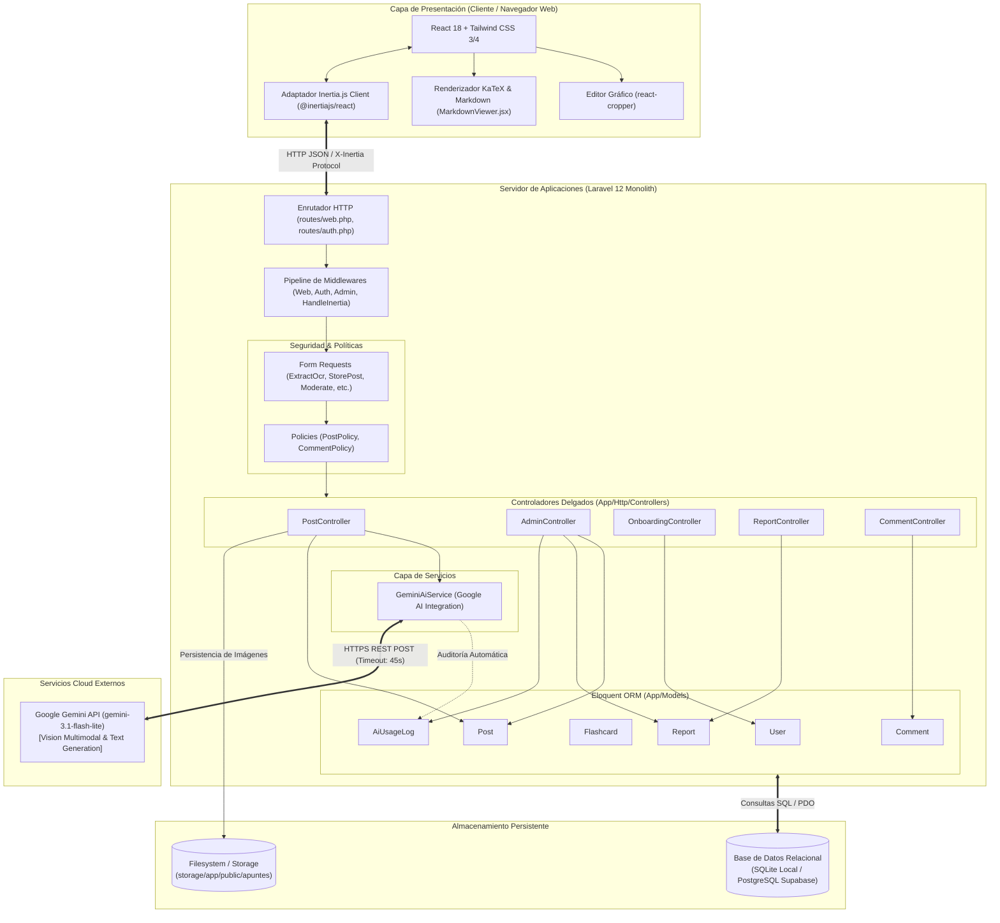

# MANUAL TÉCNICO DEL SISTEMA — SNAPSTUDY
**Plataforma Inteligente de Digitalización de Apuntes, Generación de Flashcards y Aprendizaje Adaptativo**  
*Universidad de Córdoba — Programa de Ingeniería de Sistemas*  
*Versión del Documento: 1.0.0 | Fecha de Emisión: Noviembre 2026*  

---

## 1. INTRODUCCIÓN Y ALCANCE TÉCNICO

### 1.1. Propósito del Manual Técnico
El presente documento constituye el **Manual del Sistema (Manual Técnico)** oficial de **SnapStudy**. Su objetivo es proporcionar una referencia exhaustiva, rigurosa y formal sobre la arquitectura de software, especificaciones de componentes, diseño de bases de datos, flujos de datos, seguridad, integración de servicios de Inteligencia Artificial (IA) y procedimientos operativos de despliegue y mantenimiento.

Este documento está dirigido a:
- **Desarrolladores de Software y Mantenedores:** Para comprender los patrones de diseño, estándares de código, ciclo de vida de los datos y puntos de extensión del backend (Laravel 12) y frontend (React 18 + Inertia.js v2).
- **Administradores de Servidores y DevOps:** Para guiar la configuración de entornos locales y servidores de producción (variables de entorno, enlaces simbólicos, colas de trabajo, almacenamiento persistente y base de datos).
- **Evaluadores Académicos y Docentes de Ingeniería de Sistemas:** Para auditar la rigurosidad técnica, el cumplimiento de requisitos funcionales/no funcionales y las decisiones de diseño arquitectónico implementadas en el sistema.

### 1.2. Resumen Técnico del Sistema
**SnapStudy** es una aplicación web interactiva de alto rendimiento construida bajo el paradigma de **Monolito Moderno SPA (Single Page Application)**. A través de la integración de **Laravel 12** en el backend e **Inertia.js v2 con React 18** en el frontend, la plataforma elimina la necesidad de mantener una API REST/GraphQL desacoplada con doble gestión de estados y autenticación OAuth compleja, preservando la experiencia fluida de una SPA cliente sin recargas completas de página.

> [!NOTE] Instancia de Producción Activa
> El sistema se encuentra actualmente desplegado y en operación pública en un Servidor Privado Virtual (VPS) bajo el dominio oficial: **[https://www.snapstudy.cloud/](https://www.snapstudy.cloud/)**, contando con cifrado SSL/TLS forzado, aceleración HTTP/2 y configuración Nginx optimizada.

El núcleo cognitivo de la plataforma se apoya en la API multimodal nativa de **Google Gemini (`gemini-3.1-flash-lite`)**, permitiendo:
1. **Digitalización & OCR Inteligente:** Reconocimiento óptico de caracteres en manuscritos y textos impresos, estructuración semántica en Markdown y renderizado de fórmulas físico-matemáticas en LaTeX mediante KaTeX.
2. **Evaluación de Contenido & Moderación Preventiva:** Filtrado algorítmico asistido por visión artificial para verificar legibilidad (`has_legible_text`) y autenticidad académica (`is_educational`), enrutando apuntes sospechosos a una bandeja de revisión administrativa.
3. **Generación Automatizada de Flashcards:** Síntesis pedagógica de preguntas y respuestas de alto impacto a partir del contenido de los apuntes.
4. **Motor VARK y Adaptabilidad Cognitiva:** Detección del estilo predominante de aprendizaje (*Visual, Auditivo, Lectoescritura o Kinestésico*) para personalizar la experiencia de estudio.
5. **Feed Social y Auditoría de Consumo:** Muro comunitario con paginación, filtros de búsqueda, bifurcación/guardado de apuntes, sistema de reportes comunitarios y panel de control con métricas de latencia y volumen de tokens consumidos.

---

## 2. ARQUITECTURA DEL SISTEMA

### 2.1. Patrón Arquitectónico Monolítico Moderno (Laravel + Inertia.js + React)
El sistema implementa una arquitectura por capas cohesionada mediante el adaptador **Inertia.js**:

1. **Capa Cliente (SPA React 18):**
   - El cliente interactúa con vistas declarativas escritas en React (`resources/js/Pages`).
   - Las transiciones de página son interceptadas por el motor de Inertia, el cual realiza peticiones HTTP con la cabecera `X-Inertia: true`.
   - El renderizado de fórmulas matemáticas utiliza la librería KaTeX integrada mediante `remark-math` y `rehype-katex`.
   - La manipulación y recorte de imágenes en el cliente se realiza con `react-cropper` antes del envío al servidor.

2. **Capa de Enrutamiento y Middleware (Laravel 12):**
   - Centralizada en `bootstrap/app.php` y `routes/web.php`.
   - Ejecuta validaciones de sesión, verificación de correo electrónico (`verified`), enlace CSRF (`VerifyCsrfToken`) e interceptores de control de acceso (`EnsureUserIsAdmin`).
   - El middleware `HandleInertiaRequests` inyecta props globales a toda la aplicación (estado de autenticación del usuario, estilo de aprendizaje, rol y mensajes flash).

3. **Capa de Controladores Delgados (Thin Controllers):**
   - Los controladores (`PostController`, `AdminController`, `ReportController`, etc.) delegan la validación de entrada a **Form Requests** dedicados y la autorización a **Policies** de Laravel.
   - No contienen lógica SQL cruda ni invocaciones directas a APIs externas de terceros.

4. **Capa de Servicios Especializados (Service Layer):**
   - El servicio `App\Services\GeminiAiService` aísla toda la interacción HTTP con Google Generative AI, encapsulando payloads multimodales, `generationConfig`, esquemas JSON estructurados (`responseSchema`), medición de latencia y registro en la tabla `ai_usage_logs`.

5. **Capa de Acceso a Datos (Eloquent ORM):**
   - Modelos Eloquent (`Post`, `User`, `Flashcard`, `Comment`, `Report`, `AiUsageLog`, `Interaction`, `Subject`) con definiciones explícitas de `$fillable`, `$casts`, relaciones bidireccionales, scopes locales (`active`, `pending_review`, `publicActive`) y accessors dinámicos (`image_url`).

### 2.2. Diagrama de Arquitectura del Sistema (Mermaid)



---

## 3. STACK TECNOLÓGICO Y DEPENDENCIAS

Las tecnologías y dependencias del sistema corresponden fielmente a los manifiestos `composer.json` y `package.json` del repositorio:

### 3.1. Backend y Entorno de Ejecución (PHP / Laravel)

| Componente / Paquete | Versión Exacta | Finalidad Técnica |
| :--- | :--- | :--- |
| **PHP** | `^8.2` | Lenguaje de programación del backend con tipado estricto y atributos nativos. |
| **laravel/framework** | `^12.0` | Framework web modular (enrutamiento, middleware, DI container, Eloquent ORM). |
| **inertiajs/inertia-laravel** | `^2.0` | Adaptador backend para vincular controladores con el cliente React sin API REST tradicional. |
| **laravel/sanctum** | `^4.0` | Autenticación de sesiones basada en cookies seguras para SPA de primer nivel. |
| **laravel/breeze** | `^2.4` | Scaffold de autenticación robusto (login, registro, recuperación de clave, verificación). |
| **tightenco/ziggy** | `^2.0` | Exposición de la lista de rutas nombradas de Laravel directamente en el contexto de React (`route()`). |
| **laravel/tinker** | `^2.10.1` | Consola REPL para depuración y consultas directas a Eloquent. |
| **pestphp/pest** | `^3.8` | Framework de pruebas unitarias y de integración con sintaxis declarativa. |
| **pestphp/pest-plugin-laravel** | `^3.2` | Extensiones de testing especializadas para Laravel (falsificación HTTP, aserciones de modelo). |
| **laravel/pint** | `^1.24` | Linter y formateador de código bajo el estándar PSR-12. |
| **laravel/pail** | `^1.2.2` | Visor de logs en streaming directo desde la terminal CLI. |
| **laravel/sail** | `^1.41` | Entorno de desarrollo contenerizado con Docker (opcional). |

### 3.2. Frontend y Entorno de Compilación (JavaScript / React)

| Dependencia / Biblioteca | Versión Exacta | Finalidad Técnica |
| :--- | :--- | :--- |
| **react** | `^18.2.0` | Biblioteca base de interfaz de usuario reactiva basada en componentes. |
| **react-dom** | `^18.2.0` | Renderizado del DOM virtual en navegadores web. |
| **@inertiajs/react** | `^2.0.0` | Cliente SPA de Inertia: hooks (`useForm`, `usePage`), componentes `<Link>`, `<Head>` y enrutador SPA. |
| **vite** | `^7.0.7` | Bundler y servidor de desarrollo ultra-rápido con Hot Module Replacement (HMR). |
| **@vitejs/plugin-react** | `^4.2.0` | Integración oficial de React con Vite (Fast Refresh y transformación JSX). |
| **laravel-vite-plugin** | `^2.0.0` | Conector entre el ciclo de vida de assets de Laravel y Vite. |
| **tailwindcss** | `^3.2.1` | Framework CSS utilitario para diseño moderno, responsivo y modo oscuro. |
| **@tailwindcss/forms** | `^0.5.3` | Normalizador de estilos para formularios HTML (inputs, selectores, textareas). |
| **@tailwindcss/vite** | `^4.0.0` | Plugin complementario de integración Tailwind. |
| **@headlessui/react** | `^2.0.0` | Componentes accesibles sin estilos (modales, menús desplegables y transiciones). |
| **axios** | `^1.11.0` | Cliente HTTP basado en promesas para peticiones asíncronas directas (OCR, flashcards). |
| **react-cropper** | `^2.3.3` | Componente de recorte interactivo de imágenes basado en `cropperjs`. |
| **react-markdown** | `^10.1.0` | Renderizador seguro de sintaxis Markdown a componentes React nativos. |
| **remark-gfm** | `^4.0.1` | Soporte para GitHub Flavored Markdown (tablas, listas de tareas, tachado). |
| **remark-math** | `^6.0.0` | Parser de expresiones matemáticas en formato LaTeX (`$...$` y `$$...$$`). |
| **rehype-katex** | `^7.0.1` | Transformador AST de fórmulas matemáticas a elementos HTML KaTeX. |
| **katex** | `^0.19.1` | Motor de renderizado tipográfico matemático de alta precisión. |
| **concurrently** | `^9.0.1` | Utilidad para ejecutar múltiples scripts concurrentes (servidor web, cola, logs, Vite). |

### 3.3. Base de Datos y Servicios Externos

| Componente | Configuración Real | Propósito y Comportamiento |
| :--- | :--- | :--- |
| **Motor de BD Local** | **SQLite 3** (`database/database.sqlite`) | Base de datos relacional ligera integrada para desarrollo local sin requerir servicios externos. |
| **Motor de BD Nube / Prod** | **PostgreSQL** (Supabase AWS `us-east-1` Pooler) | Base de datos transaccional con conexión SSL obligatoria (`DB_SSLMODE=require`) para despliegue. |
| **Servicio de IA** | **Google Gemini API** | Motor multimodal de procesamiento de lenguaje natural y visión artificial. |
| **Modelo de IA Activo** | `gemini-3.1-flash-lite` | Modelo optimizado de alta velocidad, bajo costo de tokens y soporte multimodal nativo. |
| **Endpoint de la API** | `https://generativelanguage.googleapis.com/v1beta/models/` | Endpoint REST para generación de contenido (`:generateContent`). |

---

## 4. ESTRUCTURA DE DIRECTORIOS DEL PROYECTO

El código fuente sigue rigurosamente la convención de carpetas de Laravel 12 y las directrices arquitectónicas de Inertia v2:

```plaintext
snapstudy/
├── app/                                 # Lógica central de la aplicación backend
│   ├── Http/
│   │   ├── Controllers/                 # Controladores delgados de la aplicación
│   │   │   ├── Auth/                    # Controladores de Breeze (Login, Registro, Password, etc.)
│   │   │   ├── AdminController.php      # Bandeja de moderación preventiva y auditoría de IA (CU20, CU21)
│   │   │   ├── CommentController.php    # Creación y eliminación de comentarios en apuntes
│   │   │   ├── Controller.php           # Controlador base abstracto de Laravel
│   │   │   ├── OnboardingController.php # Presentación y evaluación del test VARK
│   │   │   ├── PostController.php       # Gestión de apuntes, extracción OCR, generación de flashcards y feed
│   │   │   ├── ProfileController.php    # Actualización de datos del perfil y eliminación de cuenta
│   │   │   └── ReportController.php     # Creación de reportes comunitarios por infracción (CU19)
│   │   ├── Middleware/                  # Interceptores de peticiones HTTP
│   │   │   ├── EnsureUserIsAdmin.php    # Restricción de acceso exclusivo a rol 'admin' (HTTP 403)
│   │   │   └── HandleInertiaRequests.php# Inyección de props compartidas hacia el frontend React
│   │   └── Requests/                    # Validaciones desacopladas (Form Requests)
│   │       ├── ExtractOcrRequest.php    # Validación de formato y peso de imágenes para OCR
│   │       ├── ModeratePostRequest.php  # Validación de acciones de moderación (approve/hide)
│   │       ├── ProfileUpdateRequest.php # Validación de actualización de perfil
│   │       ├── ResolveReportRequest.php # Validación de resolución de reportes (accept/reject)
│   │       ├── StoreCommentRequest.php  # Validación de comentarios (texto obligatorio)
│   │       ├── StoreFlashcardsRequest.php # Validación de esquema de preguntas y respuestas
│   │       ├── StorePostRequest.php     # Validación para persistir apuntes y archivos adjuntos
│   │       └── StoreReportRequest.php   # Validación de razones y detalles de reportes
│   ├── Models/                          # Entidades Eloquent y relaciones de datos
│   │   ├── AiUsageLog.php               # Registro de auditoría técnica de consumo de IA
│   │   ├── Comment.php                  # Comentarios asociados a un apunte
│   │   ├── Flashcard.php                # Tarjetas de memoria vinculadas a un apunte
│   │   ├── Interaction.php              # Likes y guardados de apuntes
│   │   ├── Post.php                     # Apunte principal con accessors, scopes y relaciones
│   │   ├── Report.php                   # Reportes comunitarios de moderación
│   │   ├── Subject.php                  # Materias o asignaturas académicas
│   │   └── User.php                     # Modelo de usuario con rol y estilo de aprendizaje
│   ├── Policies/                        # Reglas de autorización de recursos
│   │   ├── CommentPolicy.php            # Solo el autor puede eliminar su propio comentario
│   │   └── PostPolicy.php               # Reglas de visibilidad, edición y borrado de apuntes
│   └── Services/                        # Capa de integración y lógica de negocio externa
│       └── GeminiAiService.php          # Cliente HTTP especializado para Google Gemini API
├── bootstrap/
│   └── app.php                          # Inicialización del framework, registro de middlewares y rutas (Laravel 12)
├── config/                              # Archivos de configuración (app, services, database, filesystems)
├── database/
│   ├── factories/                       # Fabricas de modelos para generación de datos de prueba
│   ├── migrations/                      # Esquema evolutivo y versionado de la base de datos relacional
│   └── seeders/
│       └── DatabaseSeeder.php           # Sembrador inicial con usuarios por defecto (admin y estudiante)
├── public/                              # Raíz web pública expuesta al servidor HTTP
│   └── storage/                         # Enlace simbólico generado hacia storage/app/public
├── resources/
│   ├── css/                             # Hojas de estilo globales y directivas de Tailwind
│   └── js/                              # Código fuente de la interfaz de usuario en React
│       ├── Components/                  # Componentes reutilizables de UI
│       │   ├── ApplicationLogo.jsx      # Isotipo y logotipo oficial de SnapStudy
│       │   ├── Checkbox.jsx             # Selector booleano accesible
│       │   ├── DangerButton.jsx         # Botón de advertencia o acciones destructivas
│       │   ├── Dropdown.jsx             # Menú desplegable interactivo
│       │   ├── InputError.jsx           # Renderizador de mensajes de error de validación
│       │   ├── InputLabel.jsx           # Etiquetas de campos de formulario
│       │   ├── MarkdownViewer.jsx       # Componente de visualización de Markdown + KaTeX + Copiado de código
│       │   ├── Modal.jsx                # Ventana modal genérica animada con Headless UI
│       │   ├── NavLink.jsx              # Enlaces de navegación con indicador de estado activo
│       │   ├── PrimaryButton.jsx        # Botón primario con gradiente característico
│       │   ├── ResponsiveNavLink.jsx    # Enlaces de navegación para dispositivos móviles
│       │   ├── SecondaryButton.jsx      # Botón de acción secundaria neutral
│       │   └── TextInput.jsx            # Campo de entrada de texto estandarizado
│       ├── Layouts/                     # Plantillas maestras de diseño
│       │   ├── AuthenticatedLayout.jsx  # Layout para usuarios autenticados (Header, Nav, Badge VARK)
│       │   └── GuestLayout.jsx          # Layout minimalista para autenticación (Login, Registro)
│       ├── Pages/                       # Vistas completas renderizadas por Inertia
│       │   ├── Admin/                   # Vistas exclusivas para administradores
│       │   │   ├── AiUsage.jsx          # Panel analítico de métricas y latencia de IA
│       │   │   └── Moderation.jsx       # Bandeja de moderación preventiva y comunitaria
│       │   ├── Auth/                    # Formularios de autenticación de Breeze
│       │   ├── Onboarding/
│       │   │   └── VarkTest.jsx         # Batería interactiva de 4 preguntas del test VARK
│       │   ├── Posts/
│       │   │   ├── Create.jsx           # Formulario con Cropper, OCR con Gemini y vista previa
│       │   │   └── Show.jsx             # Vista de lectura con Markdown, flashcards interactivas y comentarios
│       │   ├── Profile/                 # Gestión de perfil del usuario
│       │   ├── Dashboard.jsx            # Panel principal con estadísticas de apuntes, guardados y racha
│       │   ├── Explore.jsx              # Feed público con buscador, filtros y guardado rápido
│       │   └── Welcome.jsx              # Landing page de bienvenida y acceso al sistema
│       └── Utils/
│           └── text.js                  # Función utilitaria stripMarkdown para extractos limpios
├── routes/
│   ├── auth.php                         # Rutas del subsistema de autenticación
│   ├── console.php                      # Rutas de comandos Artisan CLI
│   └── web.php                          # Rutas web de la aplicación y endpoints de Inertia
├── storage/                             # Almacenamiento local interno
│   ├── app/
│   │   └── public/apuntes/              # Directorio físico donde se almacenan las fotografías de apuntes
│   └── logs/                            # Bitácoras de depuración del framework (laravel.log)
├── tests/
│   ├── Feature/                         # Pruebas de integración funcionales con Pest
│   └── Unit/                            # Pruebas unitarias
└── vite.config.js                       # Configuración de empaquetado Vite con plugins Laravel y React
```

---

## 5. MODELO Y DICCIONARIO DE DATOS (BASE DE DATOS)

A continuación se detalla la estructura física exacta de todas las tablas migradas en el sistema, obtenidas de `database/migrations/`:

### 5.1. Tabla: `users`
Almacena las cuentas de usuario, credenciales de acceso, rol asignado y estilo cognitivo de aprendizaje.

| Campo | Tipo de Dato | Restricciones | Descripción |
| :--- | :--- | :--- | :--- |
| `id` | `BIGINT UNSIGNED` | `PRIMARY KEY`, `AUTO_INCREMENT` | Identificador único del usuario. |
| `name` | `VARCHAR(255)` | `NOT NULL` | Nombre completo del usuario. |
| `email` | `VARCHAR(255)` | `NOT NULL`, `UNIQUE` | Correo electrónico institucional o personal (login). |
| `role` | `VARCHAR(20)` | `NOT NULL`, `DEFAULT 'student'` | Rol del usuario (`student` o `admin`). |
| `email_verified_at` | `TIMESTAMP` | `NULLABLE` | Fecha y hora de confirmación del correo electrónico. |
| `password` | `VARCHAR(255)` | `NOT NULL` | Hash de la contraseña (`bcrypt`). |
| `learning_style` | `ENUM` | `NULLABLE` (`'visual'`, `'auditory'`, `'reading'`, `'kinesthetic'`) | Estilo de aprendizaje predominante según el test VARK. |
| `remember_token` | `VARCHAR(100)` | `NULLABLE` | Token de persistencia de sesión ("recuérdame"). |
| `created_at` | `TIMESTAMP` | `NULLABLE` | Fecha y hora de registro de la cuenta. |
| `updated_at` | `TIMESTAMP` | `NULLABLE` | Fecha y hora de última modificación del usuario. |

### 5.2. Tabla: `posts`
Representa el apunte educativo, su contenido estructurado, visibilidad, imagen física y estado de moderación.

| Campo | Tipo de Dato | Restricciones | Descripción |
| :--- | :--- | :--- | :--- |
| `id` | `BIGINT UNSIGNED` | `PRIMARY KEY`, `AUTO_INCREMENT` | Identificador único del apunte. |
| `user_id` | `BIGINT UNSIGNED` | `NOT NULL`, `FOREIGN KEY (users.id) ON DELETE CASCADE` | Llave foránea del estudiante creador del apunte. |
| `title` | `VARCHAR(255)` | `NOT NULL` | Título representativo del apunte académico. |
| `content` | `TEXT` | `NOT NULL` | Contenido estructurado en Markdown con fórmulas en LaTeX. |
| `image` | `VARCHAR(255)` | `NULLABLE` | Ruta relativa del archivo en el disco público (`apuntes/{hash}.ext`). |
| `image_path` | `VARCHAR(255)` | `NULLABLE` | Columna complementaria para rutas heredadas de imágenes. |
| `flashcard_data` | `JSON` | `NULLABLE` | Almacenamiento serializado opcional de flashcards asociadas. |
| `subject` | `VARCHAR(255)` | `NULLABLE` | Nombre de la asignatura o categoría temática. |
| `is_public` | `BOOLEAN` | `NOT NULL`, `DEFAULT true` | Determina si el apunte es visible en el feed `Explore`. |
| `status` | `VARCHAR(30)` | `NOT NULL`, `DEFAULT 'active'` | Estado operativo: `active` (visible), `pending_review` (revisión IA), `hidden` (oculto). |
| `moderation_notes` | `TEXT` | `NULLABLE` | Justificación técnica de la IA o del administrador al moderar. |
| `created_at` | `TIMESTAMP` | `NULLABLE` | Fecha y hora de creación del apunte. |
| `updated_at` | `TIMESTAMP` | `NULLABLE` | Fecha y hora de última actualización del apunte. |

### 5.3. Tabla: `flashcards`
Tarjetas mnemotécnicas de pregunta y respuesta vinculadas a un apunte específico.

| Campo | Tipo de Dato | Restricciones | Descripción |
| :--- | :--- | :--- | :--- |
| `id` | `BIGINT UNSIGNED` | `PRIMARY KEY`, `AUTO_INCREMENT` | Identificador único de la flashcard. |
| `post_id` | `BIGINT UNSIGNED` | `NOT NULL`, `FOREIGN KEY (posts.id) ON DELETE CASCADE` | Apunte al cual pertenece la tarjeta de estudio. |
| `pregunta` | `TEXT` | `NOT NULL` | Interrogante conceptual o ejercicio generado por IA. |
| `respuesta` | `TEXT` | `NOT NULL` | Solución o explicación concisa correspondiente. |
| `created_at` | `TIMESTAMP` | `NULLABLE` | Fecha y hora de generación de la tarjeta. |
| `updated_at` | `TIMESTAMP` | `NULLABLE` | Fecha y hora de última edición de la tarjeta. |

### 5.4. Tabla: `comments`
Interacciones textuales emitidas por la comunidad de estudiantes sobre un apunte.

| Campo | Tipo de Dato | Restricciones | Descripción |
| :--- | :--- | :--- | :--- |
| `id` | `BIGINT UNSIGNED` | `PRIMARY KEY`, `AUTO_INCREMENT` | Identificador único del comentario. |
| `user_id` | `BIGINT UNSIGNED` | `NOT NULL`, `FOREIGN KEY (users.id) ON DELETE CASCADE` | Usuario autor del comentario. |
| `post_id` | `BIGINT UNSIGNED` | `NOT NULL`, `FOREIGN KEY (posts.id) ON DELETE CASCADE` | Apunte sobre el cual se comenta. |
| `content` | `TEXT` | `NOT NULL` | Texto del comentario. |
| `created_at` | `TIMESTAMP` | `NULLABLE` | Fecha y hora de publicación. |
| `updated_at` | `TIMESTAMP` | `NULLABLE` | Fecha y hora de actualización. |

### 5.5. Tabla: `saved_posts`
Tabla pivote que materializa la bifurcación/guardado (bookmark) de apuntes comunitarios en el dashboard del estudiante.

| Campo | Tipo de Dato | Restricciones | Descripción |
| :--- | :--- | :--- | :--- |
| `id` | `BIGINT UNSIGNED` | `PRIMARY KEY`, `AUTO_INCREMENT` | Identificador único del registro de guardado. |
| `user_id` | `BIGINT UNSIGNED` | `NOT NULL`, `FOREIGN KEY (users.id) ON DELETE CASCADE` | Usuario que guarda el apunte. |
| `post_id` | `BIGINT UNSIGNED` | `NOT NULL`, `FOREIGN KEY (posts.id) ON DELETE CASCADE` | Apunte guardado. |
| `created_at` | `TIMESTAMP` | `NULLABLE` | Fecha en que fue guardado. |
| `updated_at` | `TIMESTAMP` | `NULLABLE` | Fecha de actualización. |
| — | — | `UNIQUE KEY (user_id, post_id)` | Previene que un usuario guarde por duplicado el mismo apunte. |

### 5.6. Tabla: `interactions`
Registro granular de interacciones sociales (likes o guardados).

| Campo | Tipo de Dato | Restricciones | Descripción |
| :--- | :--- | :--- | :--- |
| `id` | `BIGINT UNSIGNED` | `PRIMARY KEY`, `AUTO_INCREMENT` | Identificador único de la interacción. |
| `user_id` | `BIGINT UNSIGNED` | `NOT NULL`, `FOREIGN KEY (users.id) ON DELETE CASCADE` | Usuario que interactúa. |
| `post_id` | `BIGINT UNSIGNED` | `NOT NULL`, `FOREIGN KEY (posts.id) ON DELETE CASCADE` | Apunte objetivo. |
| `type` | `ENUM` | `NOT NULL` (`'like'`, `'save'`) | Tipo de interacción registrada. |
| `created_at` | `TIMESTAMP` | `NULLABLE` | Fecha de la interacción. |
| `updated_at` | `TIMESTAMP` | `NULLABLE` | Fecha de actualización. |
| — | — | `UNIQUE KEY (user_id, post_id, type)` | Impide registrar interacciones idénticas repetidas. |

### 5.7. Tabla: `reports`
Gestión de reportes comunitarios emitidos por los estudiantes ante infracciones (CU19 / RF15).

| Campo | Tipo de Dato | Restricciones | Descripción |
| :--- | :--- | :--- | :--- |
| `id` | `BIGINT UNSIGNED` | `PRIMARY KEY`, `AUTO_INCREMENT` | Identificador único del reporte. |
| `post_id` | `BIGINT UNSIGNED` | `NOT NULL`, `FOREIGN KEY (posts.id) ON DELETE CASCADE` | Apunte denunciado. |
| `reporter_id` | `BIGINT UNSIGNED` | `NOT NULL`, `FOREIGN KEY (users.id) ON DELETE CASCADE` | Estudiante que emitió el reporte. |
| `reviewed_by` | `BIGINT UNSIGNED` | `NULLABLE`, `FOREIGN KEY (users.id) ON DELETE SET NULL` | Administrador que procesó y resolvió el reporte. |
| `reason` | `VARCHAR(50)` | `NOT NULL` | Causal del reporte (`contenido_inapropiado`, `plagio`, `spam`, `otro`). |
| `details` | `TEXT` | `NULLABLE` | Descripción complementaria aportada por el denunciante. |
| `status` | `VARCHAR(20)` | `NOT NULL`, `DEFAULT 'pending'` | Estado del reporte (`pending`, `accepted`, `rejected`). |
| `reviewed_at` | `TIMESTAMP` | `NULLABLE` | Momento exacto de resolución administrativa. |
| `created_at` | `TIMESTAMP` | `NULLABLE` | Fecha de creación del reporte. |
| `updated_at` | `TIMESTAMP` | `NULLABLE` | Fecha de actualización del reporte. |

### 5.8. Tabla: `ai_usage_logs`
Auditoría técnica del consumo de la API de Google Gemini (CU21 / RF16).

| Campo | Tipo de Dato | Restricciones | Descripción |
| :--- | :--- | :--- | :--- |
| `id` | `BIGINT UNSIGNED` | `PRIMARY KEY`, `AUTO_INCREMENT` | Identificador del log de consumo. |
| `user_id` | `BIGINT UNSIGNED` | `NOT NULL`, `FOREIGN KEY (users.id) ON DELETE CASCADE` | Usuario que originó la petición a la IA. |
| `post_id` | `BIGINT UNSIGNED` | `NULLABLE`, `FOREIGN KEY (posts.id) ON DELETE SET NULL` | Apunte vinculado al procesamiento (si aplica). |
| `type` | `VARCHAR(30)` | `NOT NULL` | Tipo de operación de IA (`ocr` o `flashcards`). |
| `model` | `VARCHAR(50)` | `NULLABLE` | Nombre del modelo LLM ejecutado (`gemini-3.1-flash-lite`). |
| `tokens_used` | `INT UNSIGNED` | `NOT NULL`, `DEFAULT 0` | Total de tokens consumidos reportados por la API. |
| `latency_ms` | `INT UNSIGNED` | `NOT NULL`, `DEFAULT 0` | Tiempo de respuesta medido en milisegundos. |
| `status` | `VARCHAR(20)` | `NOT NULL`, `DEFAULT 'success'` | Resultado de la operación (`success` o `error`). |
| `error_message` | `TEXT` | `NULLABLE` | Mensaje de excepción o código de error retornado. |
| `created_at` | `TIMESTAMP` | `NULLABLE` | Estampa de tiempo de la solicitud. |
| `updated_at` | `TIMESTAMP` | `NULLABLE` | Estampa de tiempo de actualización. |

### 5.9. Tablas Complementarias del Sistema
- `subjects`: Almacena materias personalizadas (`id`, `user_id` FK cascade, `name`, `color`, `timestamps`).
- `notes`: Tabla auxiliar de apuntes crudos (`id`, `user_id` FK cascade, `subject_id` FK null, `title`, `content_text`, `timestamps`).
- `sessions`: Manejo de sesiones de usuario en base de datos (`id` PK, `user_id`, `ip_address`, `user_agent`, `payload`, `last_activity`).
- `password_reset_tokens`: Tokens de recuperación de credenciales (`email` PK, `token`, `created_at`).
- `cache` y `cache_locks`: Cache y bloqueos distribuidos de Laravel.
- `jobs`, `job_batches` y `failed_jobs`: Gestión de colas de procesamiento asíncrono.

### 5.10. Seeders del Sistema (`database/seeders/DatabaseSeeder.php`)
El sistema cuenta con un seeder maestro ejecutable mediante `php artisan db:seed`:

1. **Usuario Administrador por Defecto:**
   - **Nombre:** `Administrador SnapStudy`
   - **Correo Electrónico:** `admin@admin.com`
   - **Contraseña:** `admin123` (cifrada con `bcrypt`)
   - **Rol:** `admin`
   - **Estilo de Aprendizaje:** `visual`
   - **Mecanismo:** `User::updateOrCreate(['email' => 'admin@admin.com'], ...)`

2. **Usuario Estudiante de Prueba:**
   - **Nombre:** `Estudiante de Prueba`
   - **Correo Electrónico:** `test@example.com`
   - **Contraseña:** `password` (cifrada con `bcrypt`)
   - **Rol:** `student`
   - **Estilo de Aprendizaje:** `visual`
   - **Mecanismo:** `User::firstOrCreate(['email' => 'test@example.com'], ...)`

---

## 6. CATÁLOGO DE RUTAS Y ENDPOINTS

A continuación se presenta el catálogo exhaustivo de rutas y endpoints de la aplicación, compilado a partir de `routes/web.php` y `routes/auth.php`:

### 6.1. Módulo Público y Autenticación General

| Método | URI / Ruta | Controlador y Acción | Middleware Requerido | Descripción Técnica |
| :--- | :--- | :--- | :--- | :--- |
| `GET` | `/` | Closure (`Inertia::render('Welcome')`) | `web` | Renderiza la landing page principal con versiones de Laravel y PHP. |
| `GET` | `/login` | `AuthenticatedSessionController@create` | `web`, `guest` | Muestra el formulario de inicio de sesión. |
| `POST` | `/login` | `AuthenticatedSessionController@store` | `web`, `guest` | Autentica las credenciales del usuario y crea la sesión. |
| `POST` | `/logout` | `AuthenticatedSessionController@destroy` | `web`, `auth` | Invalida la sesión actual y regenera el token CSRF. |
| `GET` | `/register` | `RegisteredUserController@create` | `web`, `guest` | Presenta el formulario de registro de nuevos estudiantes. |
| `POST` | `/register` | `RegisteredUserController@store` | `web`, `guest` | Registra un nuevo usuario en la tabla `users` con rol `student`. |
| `GET` | `/forgot-password` | `PasswordResetLinkController@create` | `web`, `guest` | Formulario para solicitar enlace de restablecimiento de contraseña. |
| `POST` | `/forgot-password` | `PasswordResetLinkController@store` | `web`, `guest` | Genera y envía el token de recuperación por correo. |
| `GET` | `/reset-password/{token}` | `NewPasswordController@create` | `web`, `guest` | Formulario de cambio de contraseña con token validado. |
| `POST` | `/reset-password` | `NewPasswordController@store` | `web`, `guest` | Actualiza la contraseña cifrada en la base de datos. |
| `GET` | `/verify-email` | `EmailVerificationPromptController` | `web`, `auth` | Pantalla informativa de verificación obligatoria de correo. |
| `GET` | `/verify-email/{id}/{hash}`| `VerifyEmailController` | `web`, `auth`, `signed`, `throttle:6,1` | Valida el enlace firmado y marca `email_verified_at`. |
| `POST` | `/email/verification-notification` | `EmailVerificationNotificationController@store` | `web`, `auth`, `throttle:6,1` | Reenvía el correo de verificación. |
| `GET` | `/confirm-password` | `ConfirmablePasswordController@show` | `web`, `auth` | Solicita confirmación de contraseña para operaciones sensibles. |
| `POST` | `/confirm-password` | `ConfirmablePasswordController@store` | `web`, `auth` | Valida la contraseña introducida para continuar. |
| `PUT` | `/password` | `PasswordController@update` | `web`, `auth` | Actualiza la contraseña del usuario autenticado. |

### 6.2. Módulo de Estudiante (Dashboard, Onboarding y Perfil)

| Método | URI / Ruta | Controlador y Acción | Middleware Requerido | Descripción Técnica |
| :--- | :--- | :--- | :--- | :--- |
| `GET` | `/dashboard` | Closure (`Inertia::render('Dashboard')`) | `web`, `auth`, `verified` | Panel principal: estadísticas de apuntes, guardados, racha y listas recientes. Si `learning_style` es `null`, redirige a `/onboarding`. |
| `GET` | `/onboarding` | `OnboardingController@show` | `web`, `auth` | Presenta el cuestionario VARK. Redirige al Dashboard si el estilo ya está configurado. |
| `POST` | `/onboarding` | `OnboardingController@store` | `web`, `auth` | Valida (`in:visual,auditory,reading,kinesthetic`) y guarda el estilo cognitivo en el usuario. |
| `GET` | `/profile` | `ProfileController@edit` | `web`, `auth` | Presenta las vistas de configuración del perfil de usuario. |
| `PATCH` | `/profile` | `ProfileController@update` | `web`, `auth` | Actualiza nombre y correo con `ProfileUpdateRequest`. |
| `DELETE` | `/profile` | `ProfileController@destroy` | `web`, `auth` | Elimina la cuenta del usuario previa confirmación de clave. |

### 6.3. Módulo de Apuntes, IA y Feed Comunitario

| Método | URI / Ruta | Controlador y Acción | Middleware Requerido | Descripción Técnica |
| :--- | :--- | :--- | :--- | :--- |
| `GET` | `/posts/create` | `PostController@create` | `web`, `auth` | Formulario de creación de apunte con editor de recorte y botón OCR. |
| `POST` | `/posts` | `PostController@store` | `web`, `auth` | Almacena el apunte en BD y la imagen en `storage/app/public/apuntes`. Si la IA marcó `is_educational=false`, asigna `status='pending_review'`. |
| `GET` | `/posts/extract-text` | Closure | `web`, `auth` | Redirige preventivamente hacia `/posts/create`. |
| `POST` | `/posts/extract-text` | `PostController@extractText` | `web`, `auth` | Endpoint AJAX que invoca `GeminiAiService::extractTextFromImage` con la imagen recortada. Retorna JSON con título, contenido y flag de educación. |
| `GET` | `/posts/{post}` | `PostController@show` | `web`, `auth` | Muestra el apunte individual en modo lectura. Requiere autorización (`PostPolicy::view`). Carga flashcards, comentarios y usuario. |
| `POST` | `/posts/{post}/flashcards` | `PostController@generateFlashcards` | `web`, `auth` | Invoca a Gemini para generar 5 tarjetas basadas en el contenido del apunte. Retorna lista JSON de preguntas y respuestas. |
| `POST` | `/posts/{post}/flashcards/save` | `PostController@storeFlashcards` | `web`, `auth` | Persiste las flashcards editadas o generadas en la tabla `flashcards`. Requiere `PostPolicy::update`. |
| `DELETE` | `/posts/{post}` | `PostController@destroy` | `web`, `auth` | Elimina el apunte y su archivo físico de imagen en disco. Requiere `PostPolicy::delete`. |
| `POST` | `/posts/{post}/save` | `PostController@toggleSave` | `web`, `auth` | Alterna el guardado/bifurcación (fork) del apunte en la tabla `saved_posts`. |
| `POST` | `/posts/{post}/comments` | `CommentController@store` | `web`, `auth` | Publica un nuevo comentario vinculado al apunte. |
| `DELETE` | `/comments/{comment}` | `CommentController@destroy` | `web`, `auth` | Elimina un comentario. Restringido por `CommentPolicy` al autor del mismo. |
| `POST` | `/posts/{post}/report` | `ReportController@store` | `web`, `auth` | Registra una denuncia sobre el apunte hacia la cola de moderación. |
| `GET` | `/explore` | `PostController@explore` | `web`, `auth` | Feed social público. Filtra apuntes activos (`status='active'`), paginados de a 12, con búsqueda por texto y materia. |

### 6.4. Módulo de Administración (Rutas Protegidas con Prefijo `/admin`)

| Método | URI / Ruta | Controlador y Acción | Middleware Requerido | Descripción Técnica |
| :--- | :--- | :--- | :--- | :--- |
| `GET` | `/admin/moderacion` | `AdminController@moderation` | `web`, `auth`, `admin` | Bandeja de moderación preventiva (apuntes en `pending_review`) y reportes comunitarios pendientes (`reports`). |
| `POST` | `/admin/posts/{post}/moderate` | `AdminController@moderatePost` | `web`, `auth`, `admin` | Aprueba (`status='active'`) u oculta (`status='hidden'`) un apunte en revisión preventiva con notas de moderación. |
| `POST` | `/admin/reports/{report}/resolve`| `AdminController@resolveReport` | `web`, `auth`, `admin` | Resuelve un reporte: `accept` (marca reporte aceptado y oculta el apunte) o `reject` (rechaza el reporte). |
| `GET` | `/admin/ia-usage` | `AdminController@aiUsage` | `web`, `auth`, `admin` | Tablero de control de consumo de IA: total peticiones, tokens consumidos, latencia media, tasa de éxito y desglose por tipo. |

---

## 7. COMPONENTES CRÍTICOS Y LÓGICA DE NEGOCIO (CAPA DE SERVICIOS)

### 7.1. Servicio de IA: `App\Services\GeminiAiService`
Es el núcleo de procesamiento multimodal inteligente del sistema.

#### A. Modelo Configurado y Parámetros Operativos
- **Modelo:** `gemini-3.1-flash-lite` (leído dinámicamente desde `config('services.gemini.model')` o variable `GEMINI_MODEL`).
- **Endpoint:** `https://generativelanguage.googleapis.com/v1beta/models/{model}:generateContent?key={apiKey}`
- **Timeout HTTP:** Fijado estrictamente en **45 segundos** (`Http::timeout(45)`), garantizando tolerancia ante imágenes complejas sin colgar el hilo del servidor web.
- **Entorno Local y Pruebas:** Desactiva verificación SSL en local (`$client->withoutVerifying()`) para compatibilidad en servidores de desarrollo sin bundle de certificados CA actualizado.

#### B. Flujo 1: Digitalización Multimodal & OCR (`extractTextFromImage`)
1. **Normalización de Imagen:** El método `resolveImageData` acepta instancias de `UploadedFile`, cadenas en Base64 con prefijo data URI (`data:image/...;base64,...`) o rutas de archivos en disco, resolviendo el MIME type y el stream Base64 puro.
2. **Estructura del Vision Prompt:**
   > *"Analiza esta imagen para una plataforma educativa universitaria (SnapStudy). Actúa como un estudiante de excelencia y digitalizador profesional. 1) Evalúa con rigor si la imagen contiene texto escrito a mano o impreso legible (has_legible_text)... 2) Evalúa si el texto corresponde a apuntes, notas académicas... (is_educational)... 3) Crea un título representativo... 4) Transcribe y estructura el contenido utilizando Markdown enriquecido... Si encuentras ecuaciones o fórmulas matemáticas, transcríbelas en formato LaTeX estándar utilizando $$...$$ para bloque y $...$ para línea."*
3. **Esquema de Respuesta Forzado (`responseSchema`):**
   ```json
   {
     "type": "OBJECT",
     "properties": {
       "has_legible_text": { "type": "BOOLEAN" },
       "is_educational": { "type": "BOOLEAN" },
       "title": { "type": "STRING" },
       "content": { "type": "STRING" }
     },
     "required": ["title", "content"]
   }
   ```
4. **Verificación de Seguridad:** Inspecciona el campo `finishReason` de los candidatos. Si el contenido fue bloqueado por filtros de Google (`SAFETY`, `RECITATION`, `BLOCKLIST`), aborta con `RuntimeException`.

#### C. Flujo 2: Generación Automatizada de Flashcards (`generateFlashcards`)
1. **Entrada:** Recibe el texto Markdown del apunte y la cantidad deseada de tarjetas (por defecto 5).
2. **Esquema Forzado:** Especifica `responseMimeType: 'application/json'` y un esquema de arreglo de objetos con propiedades obligatorias `question` y `answer`.
3. **Mapeo Bidireccional:** El resultado normaliza los campos de retorno a `question`, `answer`, `pregunta` y `respuesta` para máxima compatibilidad con el frontend.

#### D. Registro de Auditoría y Métricas (`recordAiUsage`)
Ante cada ejecución (exitosa o fallida), el servicio calcula con precisión de microsegundos:
- `latency_ms`: Diferencia entre el inicio y fin de la petición HTTP.
- `tokens_used`: Extraído directamente de `usageMetadata.totalTokenCount` de la respuesta de Google.
- `status`: `'success'` o `'error'`.
- `error_message`: Almacena el mensaje de excepción en caso de falla.
- Persistencia automática en la tabla `ai_usage_logs` vinculada al usuario autenticado y al apunte (`post_id`).

### 7.2. Motor VARK y Adaptabilidad Cognitiva
El sistema implementa el modelo de estilos de aprendizaje **VARK** (*Visual, Aural/Auditory, Read/Write, Kinesthetic*) desarrollado por Neil Fleming:

#### A. Algoritmo de Evaluación (`resources/js/Pages/Onboarding/VarkTest.jsx`)
1. El usuario responde una batería de **4 situaciones pedagógicas cotidianas** (aprendizaje para exámenes, orientación geográfica, técnica favorita de estudio y adopción de nuevo software).
2. Cada opción seleccionada suma un punto a uno de los cuatro contadores:
   $$\text{Puntaje} = \{ \text{visual}: v, \text{auditory}: a, \text{reading}: r, \text{kinesthetic}: k \}$$
3. Al completar la cuarta pregunta, la función `finishTest` ejecuta la reducción para determinar el vector dominante:
   $$\text{Estilo Dominante} = \arg\max_{s \in \{v, a, r, k\}} (\text{Puntaje}[s])$$
4. Se despacha mediante Inertia a `POST /onboarding` donde se valida y persiste en `users.learning_style`.

#### B. Adaptación de la Experiencia de Usuario
- **Estudiantes Visuales:** Priorización de imágenes originales recortadas con visor en alta definición, diagramas de Markdown y badges gráficos.
- **Estudiantes Lectoescritores:** Renderizado tipográfico avanzado con jerarquía de encabezados, listas, tablas y bloques de código con botón interactivo de copiado en el portapapeles.
- **Estudiantes Auditivos y Kinestésicos:** Bloque interactivo de flashcards con conmutador de respuesta oculta/revelada, volteo de tarjetas y modo de auto-evaluación activa.

### 7.3. Almacenamiento, Validación y Procesamiento de Imágenes

#### A. Pipeline de Imagen en Cliente
1. El estudiante selecciona una fotografía tomada desde su cámara móvil o disco.
2. `react-cropper` carga la imagen en un lienzo interactivo permitiendo rotar, encuadrar y recortar solo el fragmento legible del cuaderno.
3. Al confirmar, el lienzo genera un canvas restringido a una resolución máxima de **1920x1080 píxeles** exportado como Blob en formato `image/jpeg` con factor de compresión **0.8**. Esto reduce imágenes pesadas de 15 MB tomadas por celulares modernos a archivos ligeros de ~300 KB a 800 KB, optimizando el ancho de banda y la velocidad del OCR.

#### B. Validaciones en Backend
- En extracción OCR (`ExtractOcrRequest`):
  - Archivos permitidos: `jpeg, png, jpg, webp`.
  - Tamaño máximo permitido: **10 MB** (`max:10240`) o string Base64 válido.
- En persistencia final (`StorePostRequest`):
  - Archivos permitidos: `jpeg, png, jpg, webp`.
  - Tamaño máximo permitido: **5 MB** (`max:5120`).

#### C. Almacenamiento Físico y Acceso Público
- Almacenamiento: `$request->file('image')->store('apuntes', 'public')`.
- Destino en el servidor: `storage/app/public/apuntes/{hash_unico}.jpg`.
- Acceso web: Garantizado mediante el enlace simbólico `public/storage -> storage/app/public` generado por `php artisan storage:link`.
- El modelo `Post` implementa el accessor `image_url`:
  ```php
  public function getImageUrlAttribute(): ?string
  {
      if (!$this->image) return null;
      if (str_starts_with($this->image, 'http://') || str_starts_with($this->image, 'https://')) {
          return $this->image;
      }
      return asset('storage/' . ltrim($this->image, '/'));
  }
  ```

---

## 8. SEGURIDAD, AUTENTICACIÓN Y CONTROL DE ACCESO

### 8.1. Mecanismo de Autenticación y Manejo de Sesiones
- **Autenticación SPA State-Driven:** Se utiliza Laravel Sanctum y Laravel Breeze con sesiones persistidas en base de datos (`SESSION_DRIVER=database`).
- **Cookies Seguras:** La sesión viaja en una cookie encriptada (`HttpOnly`, `SameSite=Lax`).
- **Protección CSRF:** Todas las solicitudes que modifican estado (`POST`, `PUT`, `PATCH`, `DELETE`) incorporan automáticamente el token CSRF validado por el middleware de Laravel y el cliente Axios / Inertia.

### 8.2. Control de Acceso Basado en Roles (RBAC: `student` vs `admin`)
1. **Esquema de Roles:** El campo `users.role` tipifica al usuario. Por defecto, todo registro nuevo adquiere el rol `student`.
2. **Middleware `EnsureUserIsAdmin` (`admin`):**
   - Intercepta todas las rutas agrupadas bajo el prefijo `/admin/*`.
   - Verifica `$request->user()->isAdmin()`. En caso negativo, aborta inmediatamente con respuesta **HTTP 403 Forbidden**.
3. **Visibilidad de Controles en la Interfaz:**
   - La barra de navegación (`AuthenticatedLayout.jsx`) solo renderiza los accesos a "Moderación" y "Uso de IA" si el usuario autenticado posee `role === 'admin'`.

### 8.3. Políticas de Autorización Granular (Policies)

#### A. `PostPolicy` (`app/Policies/PostPolicy.php`)
- **`view(?User $user, Post $post)`:**
  - Si el usuario es administrador: acceso concedido.
  - Si el apunte está en `status === 'hidden'`: acceso denegado (HTTP 403).
  - Si el apunte está en `status === 'pending_review'`: solo accesible por el autor original o administradores.
  - Si el apunte es público (`is_public === true` y `status === 'active'`): accesible por cualquier usuario autenticado o visitante autorizado.
  - Si el apunte es privado (`is_public === false`): solo accesible por su autor.
- **`update(User $user, Post $post)`:** Solo permitido al autor del apunte o a un administrador.
- **`delete(User $user, Post $post)`:** Solo permitido al autor del apunte o a un administrador.

#### B. `CommentPolicy` (`app/Policies/CommentPolicy.php`)
- **`delete(User $user, Comment $comment)`:** Exclusivo para el usuario creador del comentario (`$user->id === $comment->user_id`).

### 8.4. Gestión de Credenciales y Llaves de API
- Las credenciales privadas (`GEMINI_API_KEY`, credenciales de bases de datos y llaves de cifrado `APP_KEY`) nunca se almacenan en el código fuente. Se inyectan exclusivamente a través del archivo de entorno `.env`, protegido de la exposición pública mediante el archivo `.gitignore`.

---

## 9. GUÍA DE INSTALACIÓN, CONFIGURACIÓN Y DESPLIEGUE

### 9.1. Requisitos del Servidor y Entorno de Ejecución

| Software / Herramienta | Versión Mínima Requerida | Observaciones |
| :--- | :--- | :--- |
| **PHP** | `>= 8.2.0` | Con extensiones: `pdo`, `pdo_sqlite` (desarrollo), `pdo_pgsql` (producción), `mbstring`, `openssl`, `tokenizer`, `xml`, `ctype`, `json`, `curl`, `fileinfo`. |
| **Composer** | `>= 2.2.0` | Gestor de paquetes de dependencias de PHP. |
| **Node.js** | `>= 18.18.0` o `>= 20.0.0` | Entorno de ejecución JavaScript para Vite y dependencias frontend. |
| **NPM** | `>= 9.0.0` | Gestor de paquetes de Node. |
| **Base de Datos** | SQLite 3 (local) / PostgreSQL `>= 14` | SQLite no requiere servicio demonio; PostgreSQL recomendado para producción. |
| **Google Gemini Key** | API Key Válida | Obtenida gratuitamente o de pago a través de [Google AI Studio](https://aistudio.google.com/). |

### 9.2. Diccionario de Variables de Entorno (`.env.example`)

| Variable | Valor por Defecto / Ejemplo | Propósito Técnico |
| :--- | :--- | :--- |
| `APP_NAME` | `SnapStudy` | Nombre de la aplicación en correos, vistas y títulos de ventana. |
| `APP_ENV` | `local` / `production` | Entorno de ejecución (determina el nivel de detalle de errores y logs). |
| `APP_KEY` | *(Generado por Artisan)* | Clave de 32 caracteres para cifrado de sesiones y datos sensibles. |
| `APP_DEBUG` | `true` (local) / `false` (prod)| Habilita o deshabilita la visualización detallada de trazas de error. |
| `APP_URL` | `http://localhost:8000` | URL canónica para generar enlaces absolutos de assets e imágenes. |
| `DB_CONNECTION` | `sqlite` o `pgsql` | Driver de base de datos (`sqlite` en local, `pgsql` en producción). |
| `DB_HOST` | `aws-0-us-east-1.pooler.supabase.com`| Host del servidor PostgreSQL (producción). |
| `DB_PORT` | `5432` | Puerto de conexión a la base de datos relacional. |
| `DB_DATABASE` | `postgres` | Nombre de la base de datos. |
| `DB_USERNAME` | `postgres.xxx` | Usuario con permisos en la base de datos. |
| `DB_PASSWORD` | `xxx` | Contraseña de la base de datos. |
| `DB_SSLMODE` | `require` | Exigencia de cifrado SSL en la conexión de base de datos remota. |
| `SESSION_DRIVER` | `database` | Almacenamiento de sesiones en la tabla `sessions`. |
| `FILESYSTEM_DISK` | `public` | Disco de almacenamiento de archivos por defecto (`storage/app/public`). |
| `QUEUE_CONNECTION` | `database` | Cola de procesamiento de trabajos asíncronos en BD. |
| `GEMINI_API_KEY` | *(Tu API Key)* | Clave de autenticación para Google Gemini API. |
| `GEMINI_MODEL` | `gemini-3.1-flash-lite` | Identificador del modelo LLM multimodal a ejecutar. |

### 9.3. Instalación Paso a Paso

#### A. Entorno de Desarrollo Local

1. **Clonar el repositorio:**
   ```bash
   git clone <URL_DEL_REPOSITORIO> snapstudy
   cd snapstudy
   ```

2. **Instalar dependencias de PHP:**
   ```bash
   composer install
   ```

3. **Instalar dependencias de Node.js:**
   ```bash
   npm install
   ```

4. **Configurar el archivo de entorno:**
   ```bash
   cp .env.example .env
   ```

5. **Generar la clave de aplicación:**
   ```bash
   php artisan key:generate
   ```

6. **Configurar la base de datos local SQLite:**
   ```bash
   # En Windows PowerShell:
   New-Item -ItemType File -Path database/database.sqlite -Force
   # En Linux / macOS:
   touch database/database.sqlite
   ```

7. **Crear el enlace simbólico de almacenamiento:**
   ```bash
   php artisan storage:link
   ```

8. **Ejecutar migraciones y sembradores (Seeders):**
   ```bash
   php artisan migrate:fresh --seed
   ```
   *Esto creará las tablas y registrará al administrador (`admin@admin.com` / `admin123`) y al estudiante de prueba (`test@example.com` / `password`).*

9. **Configurar la clave de Gemini:**
   Editar el archivo `.env` y asignar su clave:
   ```ini
   GEMINI_API_KEY=AIzaSy...tu_clave_real_aqui
   GEMINI_MODEL=gemini-3.1-flash-lite
   ```

10. **Iniciar el entorno de desarrollo:**
    ```bash
    # Opción A: Lanzador concurrente integrado de Laravel
    composer run dev

    # Opción B: Terminales independientes
    # Terminal 1:
    php artisan serve
    # Terminal 2:
    npm run dev
    ```
    Abrir el navegador en `http://localhost:8000`.

#### B. Despliegue en Servidor de Producción (Linux / Nginx / PostgreSQL)

1. Configurar variables de producción en `.env`:
   ```ini
   APP_ENV=production
   APP_DEBUG=false
   APP_URL=https://www.snapstudy.cloud
   DB_CONNECTION=pgsql
   ...
   ```
2. Instalar dependencias optimizadas:
   ```bash
   composer install --no-dev --optimize-autoloader
   npm ci
   npm run build
   ```
3. Ejecutar migraciones en modo forzado:
   ```bash
   php artisan migrate --force --seed
   php artisan storage:link
   ```
4. Optimizar rutas, configuración y eventos en caché:
   ```bash
   php artisan config:cache
   php artisan route:cache
   php artisan view:cache
   ```
5. Configurar permisos del servidor web:
   ```bash
   chown -R www-data:www-data storage bootstrap/cache
   chmod -R 775 storage bootstrap/cache
   ```

### 9.4. Especificación del Despliegue Real en Servidor VPS (`https://www.snapstudy.cloud`)

SnapStudy cuenta con una instancia de producción activa y funcional desplegada en un **Servidor Privado Virtual (VPS)** accesible globalmente a través del dominio **[https://www.snapstudy.cloud/](https://www.snapstudy.cloud/)**. A continuación se detalla la configuración técnica de la infraestructura del servidor:

#### A. Ficha Técnica del Host de Producción
- **Dominio Canónico:** `https://www.snapstudy.cloud`
- **Topología del Servidor:** Servidor Privado Virtual (VPS) Linux (Ubuntu Server / Debian) con dirección IPv4 pública dedicada.
- **Servidor Web & Proxy Reverso:** Nginx con aceleración HTTP/2 y compresión Gzip.
- **Manejador de Procesos PHP:** PHP 8.2+ FastCGI Process Manager (`php8.2-fpm`).
- **Certificación Criptográfica SSL/TLS:** Certificado X.509 emitido por Let's Encrypt Authority con cifrado TLS 1.2/1.3 forzado y renovación automática.
- **Base de Datos Transaccional:** Conexión persistente mediante SSL (`DB_SSLMODE=require`).

#### B. Configuración de Red y Enrutamiento DNS
Para garantizar la resolución del dominio hacia el VPS, se estructuraron los siguientes registros DNS autoritativos:

| Tipo de Registro | Host / Nombre | Valor / Destino | TTL | Propósito |
| :--- | :--- | :--- | :--- | :--- |
| `A` | `@` (`snapstudy.cloud`) | `<IP_PUBLICA_DEL_VPS>` | 3600 | Apunta el dominio raíz al servidor VPS. |
| `CNAME` | `www` (`www.snapstudy.cloud`) | `snapstudy.cloud` | 3600 | Redirecciona el subdominio www hacia el host principal. |

#### C. Bloque Virtual Host de Nginx (`/etc/nginx/sites-available/snapstudy.conf`)
La configuración del servidor web Nginx debe contemplar de forma crítica los tiempos de espera y el tamaño de carga para la IA y las imágenes:

```nginx
# Redirección forzada de HTTP a HTTPS
server {
    listen 80;
    listen [::]:80;
    server_name snapstudy.cloud www.snapstudy.cloud;
    return 301 https://www.snapstudy.cloud$request_uri;
}

# Servidor HTTPS Seguro
server {
    listen 443 ssl http2;
    listen [::]:443 ssl http2;
    server_name snapstudy.cloud www.snapstudy.cloud;

    # Raíz web pública de Laravel
    root /var/www/snapstudy/public;
    index index.php index.html;

    # Certificados SSL Let's Encrypt (Certbot)
    ssl_certificate /etc/letsencrypt/live/snapstudy.cloud/fullchain.pem;
    ssl_certificate_key /etc/letsencrypt/live/snapstudy.cloud/privkey.pem;
    include /etc/letsencrypt/options-ssl-nginx.conf;
    ssl_dhparam /etc/letsencrypt/ssl-dhparams.pem;

    # CRÍTICO: Permitir subida de fotografías de hasta 15 MB (OCR de apuntes)
    client_max_body_size 15M;

    # Cabeceras de seguridad HTTP
    add_header X-Frame-Options "SAMEORIGIN" always;
    add_header X-Content-Type-Options "nosniff" always;
    add_header X-XSS-Protection "1; mode=block" always;
    add_header Referrer-Policy "strict-origin-when-cross-origin" always;

    location / {
        try_files $uri $uri/ /index.php?$query_string;
    }

    # Procesamiento FastCGI PHP-FPM con timeout extendido para Gemini IA
    location ~ \.php$ {
        include snippets/fastcgi-php.conf;
        fastcgi_pass unix:/var/run/php/php8.2-fpm.sock;
        
        # CRÍTICO: Timeout alineado con los 45s de GeminiAiService
        fastcgi_read_timeout 60s;
        fastcgi_connect_timeout 60s;
        fastcgi_send_timeout 60s;
        
        fastcgi_param SCRIPT_FILENAME $realpath_root$fastcgi_script_name;
        include fastcgi_params;
    }

    # Cache estático de assets compilados por Vite
    location ~* \.(css|js|jpg|jpeg|png|gif|ico|svg|woff|woff2|ttf|eot)$ {
        expires 30d;
        add_header Cache-Control "public, no-transform";
        access_log off;
    }

    # Prohibir acceso a archivos ocultos (.env, .git, etc.)
    location ~ /\.(?!well-known).* {
        deny all;
    }
}
```

#### D. Daemon de Colas con Supervisor (`/etc/supervisor/conf.d/snapstudy-worker.conf`)
Para asegurar la ejecución ininterrumpida de procesos en segundo plano y jobs asíncronos en el VPS:

```ini
[program:snapstudy-worker]
process_name=%(program_name)s_%(process_num)02d
command=php /var/www/snapstudy/artisan queue:work database --sleep=3 --tries=3 --max-time=3600
autostart=true
autorestart=true
stopasgroup=true
killasgroup=true
user=www-data
numprocs=2
redirect_stderr=true
stdout_logfile=/var/www/snapstudy/storage/logs/worker.log
stopwaitsecs=3600
```
Comandos de activación en el VPS:
```bash
sudo supervisorctl reread
sudo supervisorctl update
sudo supervisorctl start snapstudy-worker:*
```

#### E. Automatización del Planificador de Tareas (Cron Jobs)
Para ejecutar tareas de limpieza de caché y mantenimiento programado de Laravel en el VPS:
```bash
# Editar crontab del usuario del servidor web
sudo crontab -u www-data -e

# Agregar la siguiente directiva ejecutada cada minuto:
* * * * * cd /var/www/snapstudy && php artisan schedule:run >> /dev/null 2>&1
```

#### F. Pipeline de Actualización Continua en el VPS (`deploy.sh`)
Script de despliegue automatizado utilizado para actualizar el código del VPS sin interrupción de servicio:

```bash
#!/bin/bash
set -e

echo "🚀 Iniciando despliegue de SnapStudy en https://www.snapstudy.cloud..."

# Entrar al directorio del proyecto
cd /var/www/snapstudy

# 1. Poner aplicación en modo mantenimiento
php artisan down --message="Actualizando plataforma educativa SnapStudy..." --retry=60

# 2. Descargar últimos cambios del repositorio
git pull origin main

# 3. Instalar dependencias de PHP sin dependencias de desarrollo
composer install --no-dev --no-interaction --prefer-dist --optimize-autoloader

# 4. Compilar assets estáticos del frontend React
npm ci
npm run build

# 5. Ejecutar migraciones de base de datos
php artisan migrate --force

# 6. Reconstruir enlaces simbólicos de almacenamiento
php artisan storage:link

# 7. Optimizar caché de Laravel (rutas, configuración y vistas)
php artisan optimize:clear
php artisan config:cache
php artisan route:cache
php artisan view:cache

# 8. Reiniciar colas y recargar PHP-FPM
sudo supervisorctl restart snapstudy-worker:*
sudo systemctl reload php8.2-fpm

# 9. Levantar la aplicación
php artisan up

echo "✅ ¡Despliegue completado exitosamente en https://www.snapstudy.cloud!"
```

#### G. Política de Copias de Seguridad (Backups) del VPS
- **Fotografías de Apuntes:** Respaldo diario incremental del directorio `/var/www/snapstudy/storage/app/public/apuntes/` mediante `rsync` hacia almacenamiento seguro fuera del VPS.
- **Base de Datos:** Volcado automatizado diario vía `pg_dump` con retención rotativa de 30 días para recuperación ante desastres (DRP).

### 9.5. Solución de Problemas Comunes de Despliegue

| Síntoma o Error | Causa Raíz Probable | Procedimiento de Solución |
| :--- | :--- | :--- |
| **Error 500 / "Permission denied" en storage** | El servidor web (`www-data` o `nginx`) no tiene permisos de escritura en carpetas temporales. | Ejecutar `chmod -R 775 storage bootstrap/cache` y asegurar la propiedad del usuario del servidor web. |
| **Imágenes 404 al visualizar apuntes** | Falta el enlace simbólico entre `storage/app/public` y `public/storage`. | Ejecutar `php artisan storage:link`. Si ya existía un enlace roto, borrar `public/storage` y volver a crearlo. |
| **Error "Falta la configuración de GEMINI_API_KEY"** | La variable `GEMINI_API_KEY` está vacía o la caché de configuración no se ha actualizado. | Agregar la clave en `.env` y limpiar la caché con `php artisan config:clear` u `php artisan optimize:clear`. |
| **Error HTTP 429 ("Resource Exhausted") en IA** | Se ha superado la cuota de peticiones por minuto de la clave gratuita de Google AI Studio. | Esperar 60 segundos antes de volver a solicitar OCR o alternar a una clave con cuota superior en `.env`. |
| **Error "Vite manifest not found"** | No se han compilado los assets estáticos para producción. | Ejecutar en la terminal `npm run build` para generar la carpeta `public/build/manifest.json`. |
| **Error en pruebas con base de datos** | La base de datos SQLite en memoria o disco no tiene permisos. | Ejecutar `php artisan config:clear` y verificar que el archivo `database/database.sqlite` exista y tenga permisos de lectura/escritura. |

---

## 10. CONCLUSIONES Y RECOMENDACIONES DE MANTENIMIENTO

1. **Rendimiento de Consultas (Problema N+1):** Se debe mantener la política de consultar relaciones con eager loading (`with('user')`, `withCount('flashcards')`) en todo nuevo endpoint para conservar tiempos de respuesta inferiores a 100 ms en la base de datos.
2. **Monitoreo de Costos de IA:** Revisar periódicamente la vista de administración `/admin/ia-usage` para auditar la latencia media y el volumen de tokens consumidos, previniendo sobrecostos o saturación de cuota.
3. **Resguardo de Archivos Físicos:** En entornos de producción escalables (ej. contenedores Docker efímeros o Kubernetes), se recomienda configurar el disco `s3` en `config/filesystems.php` para almacenar las fotografías de los apuntes en un bucket compatible con AWS S3 en lugar del disco local.
4. **Validación Continua:** Toda contribución debe pasar la suite completa de pruebas de integración con Pest (`php artisan test`) y el formateador de estándares PSR-12 (`./vendor/bin/pint`) antes de su despliegue a producción.

---
*Manual Técnico redactado y auditado por el Equipo de Arquitectura de Software de SnapStudy — Universidad de Córdoba.*

